<div align="center">



**Tracks how Reddit talks about counterfeit goods and scores the sentiment of every thread.**


</div>

---

## ✨ What it does

1. Pulls the current **hot posts** from a subreddit (the example run uses `r/Reps`, a replica-watch community) through the official Reddit API.
2. For each post, combines the title, body and all comments into one text, trimmed to about 2,000 characters.
3. Scores it with a **DistilBERT sentiment model** (the Hugging Face default, fine-tuned on SST-2), giving a `POSITIVE` or `NEGATIVE` label and a confidence score.
4. Saves everything to a CSV so you can sort, chart and compare threads.

Posts are fetched slowly (a 2-second pause between each) to respect Reddit's rate limits. If a thread can't be scored, its label is `ERROR` with a score of `0.0`.

| Column | Meaning |
|---|---|
| `title`, `url` | The post |
| `score`, `num_comments` | Reddit upvotes and comment count |
| `created_utc`, `created_date` | When it was posted |
| `sentiment_label`, `sentiment_score` | Model verdict and confidence |

---

## 🚀 Quick start

```bash
git clone https://github.com/aryankhanna1409/fakespotter.git
cd fakespotter

pip install -r requirements.txt
```

1. Create a "script" app at [reddit.com/prefs/apps](https://www.reddit.com/prefs/apps) to get a client ID and secret.
2. Set them as environment variables:

```bash
export REDDIT_CLIENT_ID="your-client-id"
export REDDIT_CLIENT_SECRET="your-client-secret"
# optional: export REDDIT_USER_AGENT="FakeSpotter/1.0 (by u/your-username)"
```

3. Run it:

```bash
python fakespotter/fakespotter.py
```

The first run downloads the sentiment model. Results are written to `fakewatches_deep_sentiment.csv` in the folder you run from.

---

## 📁 What's in the repo

| Path | Purpose |
|---|---|
| `fakespotter/fakespotter.py` | The scraper and sentiment scorer |
| `fakespotter/fakewatches_deep_sentiment.csv` | Sample output: 100 posts with sentiment |
| `fakespotter/fake_watches_reddit_posts.csv` | Earlier sample: 30 posts, titles and metadata only |

Reddit is the only source implemented so far.

---

<div align="center">

Reads public discussion only

</div>
